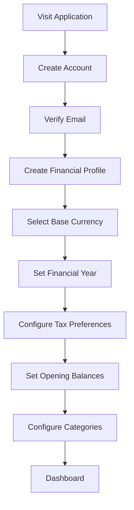
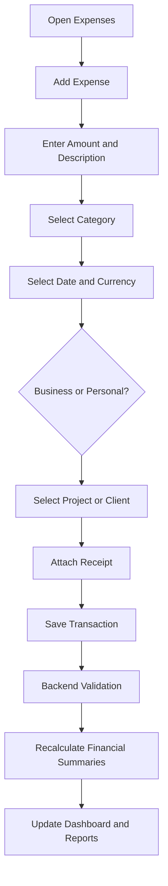
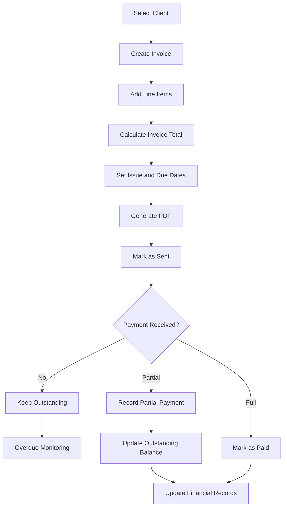
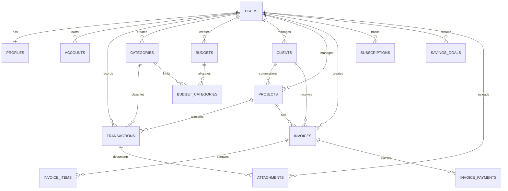
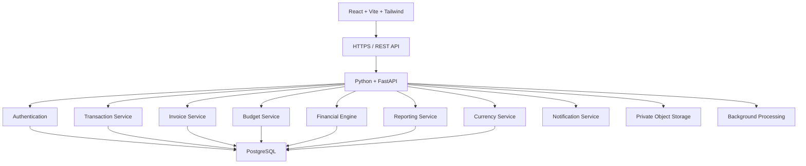
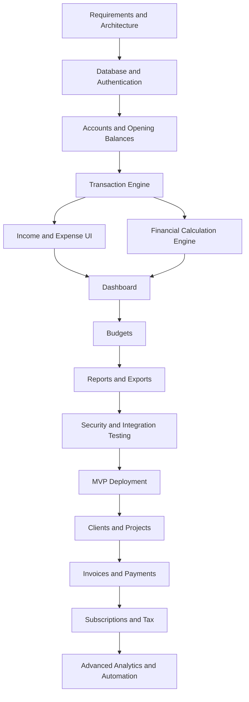

# Freelancer Finance
## Product Requirements Document (PRD)

**Document version:** 1.0  
**Product type:** Web Application  
**Target audience:** Independent Freelancers  
**Product scope:** Complete Financial Management  
**Status:** Development Planning

---

# 1. Product Overview

## 1.1 Vision

Build a centralized financial management application that enables independent freelancers to manage income, expenses, clients, projects, invoices, budgets, subscriptions, savings, taxes, and financial reports through one integrated system.

The application should not require users to understand accounting to use it effectively. It should handle financial calculations and present results in language ordinary freelancers understand.

## 1.2 Problem Statement

Independent freelancers often manage their finances using disconnected tools:

- Income is recorded in spreadsheets.
- Expenses are tracked manually.
- Invoices are created in separate applications.
- Subscriptions are forgotten.
- Taxes are calculated independently.
- Client payments are difficult to reconcile.
- Financial performance is unclear.
- Business and personal finances become mixed.

The application solves this fragmentation through a unified financial workspace.

## 1.3 Target Audience

| User Segment | Financial Requirements |
|---|---|
| Software developers | Software subscriptions, project income, hardware, hosting |
| Graphic designers | Creative software, equipment, client payments |
| Content creators | Production costs, platform revenue, equipment |
| Writers | Client invoices, subscriptions, research expenses |
| Digital marketers | Advertising costs, campaign expenses, client revenue |
| Consultants | Hourly billing, retainers, project profitability |
| Virtual assistants | Multiple clients, recurring income, operating expenses |

The application must support different freelance professions without hardcoding profession-specific financial rules.

## 1.4 Product Objectives

1. Centralize all financial records.
2. Provide accurate income and expense tracking.
3. Help users manage irregular income.
4. Track outstanding payments and invoices.
5. Measure client and project profitability.
6. Support budgets and financial goals.
7. Estimate tax reserves.
8. Generate comprehensive financial reports.
9. Reduce manual data entry through automation.
10. Protect financial data and maintain reliable records.

## 1.5 Non-Goals for Initial Release

The following capabilities are excluded from the initial release:

- Full double-entry accounting interface.
- Bank transfers and payment processing.
- Direct tax filing.
- Payroll management.
- Investment portfolio management.
- Lending and credit services.
- Automated bank synchronization.
- Native Android and iOS applications.

---

# 2. Product Modules

The application consists of 12 functional modules.

## 2.1 Dashboard

The dashboard is the application's primary workspace.

It must answer six questions:

1. How much did I earn?
2. How much did I spend?
3. How much money did I actually receive?
4. How much money remains?
5. How much money am I expecting?
6. What financial obligations are coming up?

### Dashboard Components

| Component | Required Information |
|---|---|
| Total Income | Received income in selected period |
| Total Expenses | Recorded expenses |
| Net Cash Flow | Cash received minus cash paid |
| Business Profit | Revenue minus business expenses |
| Outstanding Invoices | Unpaid invoice balance |
| Tax Reserve | Amount allocated for estimated taxes |
| Savings | Current savings balance |
| Budget Utilization | Spending against monthly budget |
| Income Chart | Income trend |
| Expense Chart | Category breakdown |
| Recent Activity | Latest transactions |
| Upcoming Obligations | Bills, subscriptions, invoice due dates |

### Dashboard Interactions

- Select reporting period.
- Switch currencies where supported.
- Click financial cards to view underlying transactions.
- Filter business and personal finances.
- View transaction details.
- Create transactions directly.
- Export dashboard reports.

**Acceptance Criteria:** Every dashboard metric must be calculated from actual financial records. No financial metric should be hardcoded or independently calculated in the frontend.

## 2.2 Transaction Management

Manages all financial movements.

Primary transaction types:

- Income.
- Expense.
- Transfer.

### Transaction Fields

| Field | Type | Requirement |
|---|---|---|
| Transaction ID | UUID | Automatic |
| Type | Enum | Required |
| Amount | Decimal | Required, greater than zero |
| Currency | Currency code | Required |
| Description | Text | Required |
| Category | Foreign key | Required |
| Date | Date | Required |
| Payment Account | Foreign key | Optional initially |
| Payment Method | Enum | Optional |
| Client | Foreign key | Optional |
| Project | Foreign key | Optional |
| Classification | Enum | Business or personal |
| Attachment | File reference | Optional |
| Notes | Text | Optional |

### Functionality

- Create transactions.
- Edit transactions.
- Delete or archive transactions.
- Search transactions.
- Filter by date, amount, type, category, client, and project.
- Sort by date and amount.
- Bulk categorization.
- Duplicate detection.
- CSV import and export.
- Transaction history.

Business and personal transactions must remain distinguishable.

## 2.3 Income Management

Features:

- Manual income entry.
- Client association.
- Project association.
- Income source classification.
- Platform fee recording.
- Gross and net income.
- Partial payments.
- Refunds.
- Recurring income.
- Expected income.
- Payment history.

Income sources:

- Direct clients.
- Freelance marketplaces.
- Consulting.
- Retainers.
- Digital products.
- Affiliate income.
- Other.

Each income record should distinguish:

- Gross amount.
- Platform or transaction fees.
- Net amount received.
- Original currency.
- Converted base-currency amount.

## 2.4 Expense Management

Features:

- Manual expense creation.
- Receipt uploads.
- Category management.
- Vendor management.
- Recurring expenses.
- Project allocation.
- Client allocation.
- Tax-deductibility classification.
- Payment status.
- Expense notes.
- Search and filtering.

Suggested default categories:

- Software subscriptions.
- Hardware and equipment.
- Internet and utilities.
- Office supplies.
- Marketing and advertising.
- Transportation.
- Travel and accommodation.
- Education and courses.
- Freelance contractors.
- Professional services.
- Bank and transaction fees.
- Workspace and rent.
- Meals and entertainment.
- Miscellaneous.

Users must be able to create custom categories.

## 2.5 Budget Management

Support:

- Monthly budgets.
- Quarterly budgets.
- Annual budgets.
- Overall spending budgets.
- Category-specific budgets.
- Project budgets.
- Personal spending budgets.

Features:

- Spending limits.
- Actual spending calculations.
- Remaining budget calculations.
- Utilization percentages.
- Spending alerts.
- Planned-versus-actual comparisons.
- Historical budget reports.
- Optional budget rollover.

Example:

| Category | Budget | Actual | Remaining |
|---|---:|---:|---:|
| Software | $100 | $75 | $25 |
| Equipment | $200 | $150 | $50 |
| Marketing | $150 | $120 | $30 |
| Internet | $60 | $60 | $0 |

## 2.6 Client Management

Client records should include:

- Client name.
- Company name.
- Email.
- Phone.
- Billing address.
- Country.
- Default currency.
- Payment terms.
- Notes.
- Client status.

Client financial overview:

- Total invoiced.
- Total received.
- Outstanding balance.
- Total project revenue.
- Associated expenses.
- Project profitability.
- Payment history.

## 2.7 Project Management

A project represents a financial engagement with a client.

Required fields:

- Project name.
- Client.
- Description.
- Start date.
- Expected completion date.
- Agreed amount.
- Currency.
- Project status.
- Budget.
- Revenue.
- Expenses.
- Platform fees.
- Profitability.

Project profitability must account for allocated costs without counting the same expense twice in overall financial reporting.

## 2.8 Invoice Management

Features:

- Create invoices.
- Add client information.
- Add line items.
- Set quantities and rates.
- Apply discounts.
- Apply configurable taxes.
- Calculate invoice totals.
- Generate invoice numbers.
- Set issue and due dates.
- Export PDF.
- Record payments.
- Support partial payments.
- Track overdue invoices.
- Record cancellations and credit adjustments.

### Invoice Statuses

| Status | Meaning |
|---|---|
| Draft | Not issued |
| Sent | Issued to client |
| Partially Paid | Some payment received |
| Paid | Fully settled |
| Overdue | Unpaid beyond due date |
| Cancelled | Cancelled invoice |

Maintain a payment ledger associated with each invoice.

An invoice being issued must never automatically count as received income.

## 2.9 Recurring Expenses and Subscriptions

Features:

- Subscription name.
- Vendor.
- Amount.
- Currency.
- Billing frequency.
- Next payment date.
- Start date.
- End date.
- Category.
- Cancellation status.
- Reminder configuration.

Supported recurrence:

- Weekly.
- Monthly.
- Quarterly.
- Semi-annually.
- Annually.
- Custom interval.

Provide monthly and annual subscription cost summaries.

Expected renewals must not automatically become confirmed expenses.

## 2.10 Tax Management

This module provides tax estimation and planning, not tax filing.

Features:

- Tax year configuration.
- Country and jurisdiction settings.
- Tax reserve percentage.
- Estimated taxable income.
- Deductible expense classification.
- Estimated tax liability.
- Tax payments.
- Tax reserve balance.
- Tax reports.

Tax rules must be configurable by jurisdiction.

The application must distinguish tax estimates from actual tax liabilities and must not assume all business expenses are deductible.

## 2.11 Savings and Financial Goals

Features:

- Create savings goals.
- Set target amounts.
- Set target dates.
- Record contributions.
- Track progress.
- Set emergency fund targets.
- Track available reserves.
- View contribution history.

Examples:

- Emergency fund.
- New laptop.
- Office equipment.
- Business expansion.
- Personal savings.

Savings goals must remain distinguishable from actual verified account balances.

## 2.12 Reports and Analytics

### Financial Reports

- Income statement.
- Cash flow statement.
- Income summary.
- Expense summary.
- Profit and loss.
- Budget performance.
- Tax summary.

### Operational Reports

- Client profitability.
- Project profitability.
- Invoice aging.
- Payment history.
- Subscription expenditure.

### Analytical Reports

- Month-over-month comparison.
- Year-over-year comparison.
- Income trends.
- Expense trends.
- Average monthly income.
- Income concentration by client.
- Expense concentration by category.

Export formats:

- PDF.
- CSV.
- XLSX.

---

# 3. User Roles and Permissions

The initial product supports one primary role.

| Role | Permissions |
|---|---|
| Account Owner | Full access to their own financial records |

Database ownership should support future multi-user expansion.

Every user must only access records associated with their account.

Team permissions are excluded from the MVP.

---

# 4. Core User Workflows

## 4.1 Registration and Onboarding

### Onboarding Information

- Full name.
- Email.
- Country of residence.
- Base currency.
- Timezone.
- Financial year start.
- Freelance profession (optional).
- Business start date (optional).
- Tax estimation preferences (optional).
- Initial account balances.

Optional onboarding steps should be skippable.

Users must be able to enter opening balances to ensure accurate financial reporting from the beginning.

## 4.2 Recording an Expense

Quick-entry fields:

- Amount.
- Description.
- Category.
- Date.

All other fields may be optional.

## 4.3 Recording Income

1. Open income management.
2. Select Add Income.
3. Enter the received amount.
4. Select client or income source.
5. Associate a project if applicable.
6. Record platform fees.
7. Select currency.
8. Set received date.
9. Save.
10. Update financial summaries.

## 4.4 Creating and Settling an Invoice

Payment recording must create the actual income transaction and link it to the invoice payment record.

It must not create duplicate income.

## 4.5 Monthly Financial Review

At the end of each month, users should be able to:

1. Review received income.
2. Review outstanding invoices.
3. Review expenses.
4. Compare expenses against budgets.
5. Review subscription costs.
6. Review estimated tax obligations.
7. Review savings contributions.
8. Compare performance against previous months.
9. Generate a monthly report.

Reports must be reproducible and use consistent financial inclusion rules.

## 4.6 Managing Subscriptions

1. Create subscription.
2. Enter amount and billing frequency.
3. Set next payment date.
4. Assign category.
5. Enable reminders.
6. Generate expected future expense occurrences.
7. Record actual payment.
8. Update subscription history.

Expected payments and confirmed payments must remain separate.

---

# 5. Functional Requirements

| ID | Requirement | Priority |
|---|---|---|
| FR-001 | User registration and login | P0 |
| FR-002 | User profile and preferences | P0 |
| FR-003 | Create, edit, delete income | P0 |
| FR-004 | Create, edit, delete expenses | P0 |
| FR-005 | Manage categories | P0 |
| FR-006 | Transaction search and filters | P0 |
| FR-007 | Financial dashboard | P0 |
| FR-008 | Monthly financial summaries | P0 |
| FR-009 | Monthly budgets | P0 |
| FR-010 | CSV transaction export | P0 |
| FR-011 | Client management | P1 |
| FR-012 | Project management | P1 |
| FR-013 | Invoice generation | P1 |
| FR-014 | Partial invoice payments | P1 |
| FR-015 | Recurring transactions | P1 |
| FR-016 | Receipt attachments | P1 |
| FR-017 | Multi-currency support | P1 |
| FR-018 | Tax estimation | P1 |
| FR-019 | Savings goals | P2 |
| FR-020 | Advanced financial analytics | P2 |
| FR-021 | Automated receipt extraction | P2 |
| FR-022 | Bank statement import | P2 |
| FR-023 | AI financial insights | P2 |

### Priority Definitions

- P0: Required for the first usable release.
- P1: Important for the complete freelancer-focused release.
- P2: Advanced capabilities for subsequent releases.

## 5.1 Non-Functional Requirements

| Area | Requirement |
|---|---|
| Security | Secure authentication and authorization |
| Privacy | User-level data isolation |
| Performance | Dashboard target under 2 seconds under normal operating conditions |
| Reliability | Failed requests must not leave inconsistent financial records |
| Accuracy | Monetary calculations must use decimal arithmetic |
| Responsiveness | Desktop, tablet, and mobile browser support |
| Accessibility | Keyboard navigation and accessible form labels |
| Scalability | Support growing users and transaction volume |
| Maintainability | Modular frontend and backend |
| Auditability | Track important financial record modifications |
| Backup | Regular backups and recovery procedures |

---

# 6. Database Schema

## 6.1 Database Architecture

Use PostgreSQL as the primary database.

The data model should be relational because financial records have relationships that must remain consistent.

### Entity Relationship Diagram

## 6.2 Core Database Tables

### A. Users

**Table: `users`**

| Column | Type |
|---|---|
| id | UUID |
| email | VARCHAR |
| auth_provider_id | VARCHAR |
| created_at | TIMESTAMPTZ |
| updated_at | TIMESTAMPTZ |

Supabase Auth should remain the authentication source of truth. Do not duplicate passwords or independently manage authentication credentials.

### B. Profiles

**Table: `profiles`**

| Column | Type |
|---|---|
| user_id | UUID, PK/FK |
| full_name | VARCHAR |
| country_code | CHAR(2) |
| base_currency | CHAR(3) |
| timezone | VARCHAR |
| financial_year_start | DATE |
| profession | VARCHAR |
| created_at | TIMESTAMPTZ |
| updated_at | TIMESTAMPTZ |

### C. Accounts

**Table: `accounts`**

Represents bank accounts, cash, wallets, and other financial accounts.

| Column | Type |
|---|---|
| id | UUID |
| user_id | UUID |
| name | VARCHAR |
| account_type | VARCHAR |
| currency | CHAR(3) |
| opening_balance | NUMERIC(19,4) |
| opening_balance_date | DATE |
| is_active | BOOLEAN |
| created_at | TIMESTAMPTZ |

Balances should derive from opening balances and financial transactions.

### D. Categories

**Table: `categories`**

| Column | Type |
|---|---|
| id | UUID |
| user_id | UUID |
| name | VARCHAR |
| type | ENUM |
| parent_category_id | UUID, nullable |
| is_system | BOOLEAN |
| is_active | BOOLEAN |
| created_at | TIMESTAMPTZ |

Category types should distinguish income, expense, and transfer classifications.

### E. Transactions

**Table: `transactions`**

The central financial records table.

| Column | Type |
|---|---|
| id | UUID |
| user_id | UUID |
| account_id | UUID, nullable |
| category_id | UUID |
| client_id | UUID, nullable |
| project_id | UUID, nullable |
| type | ENUM |
| classification | ENUM |
| description | TEXT |
| amount | NUMERIC(19,4) |
| currency | CHAR(3) |
| exchange_rate | NUMERIC(20,10) |
| base_amount | NUMERIC(19,4) |
| transaction_date | DATE |
| payment_method | VARCHAR |
| notes | TEXT |
| status | ENUM |
| created_at | TIMESTAMPTZ |
| updated_at | TIMESTAMPTZ |

Recommended transaction types:

- Income.
- Expense.
- Transfer.

Recommended classifications:

- Business.
- Personal.

Transfers must not be counted as income or expenses in consolidated financial reports.

### F. Clients

**Table: `clients`**

| Column | Type |
|---|---|
| id | UUID |
| user_id | UUID |
| name | VARCHAR |
| company_name | VARCHAR |
| email | VARCHAR |
| phone | VARCHAR |
| billing_address | TEXT |
| country_code | CHAR(2) |
| currency | CHAR(3) |
| payment_terms_days | INTEGER |
| notes | TEXT |
| status | ENUM |
| created_at | TIMESTAMPTZ |

### G. Projects

**Table: `projects`**

| Column | Type |
|---|---|
| id | UUID |
| user_id | UUID |
| client_id | UUID |
| name | VARCHAR |
| description | TEXT |
| agreed_amount | NUMERIC(19,4) |
| currency | CHAR(3) |
| budget_amount | NUMERIC(19,4) |
| start_date | DATE |
| deadline | DATE |
| status | ENUM |
| created_at | TIMESTAMPTZ |

### H. Invoices

**Table: `invoices`**

| Column | Type |
|---|---|
| id | UUID |
| user_id | UUID |
| client_id | UUID |
| project_id | UUID, nullable |
| invoice_number | VARCHAR |
| issue_date | DATE |
| due_date | DATE |
| currency | CHAR(3) |
| subtotal | NUMERIC(19,4) |
| discount | NUMERIC(19,4) |
| tax_amount | NUMERIC(19,4) |
| total_amount | NUMERIC(19,4) |
| status | ENUM |
| notes | TEXT |
| created_at | TIMESTAMPTZ |

**Table: `invoice_items`**

| Column | Type |
|---|---|
| id | UUID |
| invoice_id | UUID |
| description | TEXT |
| quantity | NUMERIC(19,4) |
| unit_price | NUMERIC(19,4) |
| tax_rate | NUMERIC(9,4) |
| line_total | NUMERIC(19,4) |

**Table: `invoice_payments`**

| Column | Type |
|---|---|
| id | UUID |
| invoice_id | UUID |
| transaction_id | UUID |
| amount | NUMERIC(19,4) |
| currency | CHAR(3) |
| payment_date | DATE |
| payment_method | VARCHAR |
| reference | VARCHAR |
| created_at | TIMESTAMPTZ |

Invoice payment operations must be transactional.

### I. Budgets

**Table: `budgets`**

| Column | Type |
|---|---|
| id | UUID |
| user_id | UUID |
| name | VARCHAR |
| period_type | ENUM |
| start_date | DATE |
| end_date | DATE |
| total_limit | NUMERIC(19,4) |
| currency | CHAR(3) |
| created_at | TIMESTAMPTZ |

**Table: `budget_categories`**

| Column | Type |
|---|---|
| id | UUID |
| budget_id | UUID |
| category_id | UUID |
| allocated_amount | NUMERIC(19,4) |

### J. Subscriptions

**Table: `subscriptions`**

| Column | Type |
|---|---|
| id | UUID |
| user_id | UUID |
| category_id | UUID |
| name | VARCHAR |
| vendor | VARCHAR |
| amount | NUMERIC(19,4) |
| currency | CHAR(3) |
| billing_frequency | ENUM |
| start_date | DATE |
| next_payment_date | DATE |
| end_date | DATE, nullable |
| status | ENUM |
| reminder_days | INTEGER |

### K. Savings Goals

**Table: `savings_goals`**

| Column | Type |
|---|---|
| id | UUID |
| user_id | UUID |
| name | VARCHAR |
| target_amount | NUMERIC(19,4) |
| currency | CHAR(3) |
| target_date | DATE |
| current_allocated_amount | NUMERIC(19,4) |
| status | ENUM |

For a rigorous implementation, store individual contributions in a separate `savings_contributions` table.

### L. Attachments

**Table: `attachments`**

| Column | Type |
|---|---|
| id | UUID |
| user_id | UUID |
| transaction_id | UUID, nullable |
| file_name | VARCHAR |
| storage_path | TEXT |
| mime_type | VARCHAR |
| file_size | BIGINT |
| uploaded_at | TIMESTAMPTZ |

Use private object storage and signed URLs.

## 6.3 Additional Production Tables

| Table | Purpose |
|---|---|
| exchange_rates | Historical exchange rates |
| tax_profiles | Tax jurisdiction and settings |
| tax_payments | Recorded tax payments |
| recurring_rules | Recurrence definitions |
| recurring_occurrences | Expected and generated transactions |
| savings_contributions | Savings history |
| vendors | Expense payees |
| audit_logs | Record modification history |
| notifications | Application notifications |
| import_batches | Track CSV imports |
| import_rows | Individual imported records |
| invoice_number_sequences | Safe invoice numbering |
| financial_periods | Reporting-period controls |

## 6.4 Database Integrity Rules

1. Every user-owned record must include a `user_id` or be protected through an ownership relationship.
2. Use foreign keys for relationships.
3. Use `NUMERIC`, never floating-point types, for monetary amounts.
4. Use database transactions for multi-record financial operations.
5. Enforce unique invoice numbers per user.
6. Prevent invalid transaction amounts.
7. Preserve historical exchange rates.
8. Store original currency values alongside converted values.
9. Maintain audit trails for important changes.
10. Never delete invoice payment records without handling their linked financial transactions.

Prepare the architecture for double-entry bookkeeping internally, even if the MVP initially exposes a simpler transaction ledger.

---

# 7. Financial Calculation Engine

Financial calculations must be centralized in the backend.

Do not scatter formulas across React components.

## 7.1 Core Formulas

| Metric | Calculation |
|---|---|
| Gross Income | Total gross income recorded |
| Net Received Income | Gross income - fees - withholding |
| Total Expenses | Sum of qualifying expenses |
| Net Cash Flow | Cash inflows - cash outflows |
| Operating Profit | Business revenue - operating expenses |
| Outstanding Invoices | Invoice total - allocated payments |
| Budget Remaining | Budget limit - qualifying expenses |
| Budget Utilization | Spending / budget limit × 100 |
| Savings Rate | Savings contributions / defined income × 100 |
| Average Monthly Income | Income over period / number of months |
| Client Profitability | Client revenue - allocated client costs |
| Project Profitability | Project revenue - allocated project costs |

## 7.2 Accounting Rules

The system must distinguish cash-basis and accrual-basis reporting.

Examples:

- An issued invoice represents an accounts receivable balance.
- A payment received represents a cash inflow.
- An unpaid invoice must not appear as received income in cash-basis reporting.
- A transfer between owned accounts is not new income.
- A refund must reverse or adjust the relevant financial activity rather than being misclassified as ordinary income.

## 7.3 Currency Calculations

Every financial record must preserve:

1. Original amount.
2. Original currency.
3. Exchange rate used.
4. Converted base amount.
5. Conversion date.
6. Exchange-rate source.

Historical reports must use the exchange rate associated with the original transaction, not today's rate.

## 7.4 Calculation Tests

Automated tests must cover:

- Partial invoice payments.
- Overpayments.
- Refunds.
- Zero-value transactions.
- Currency conversion.
- Transactions on month boundaries.
- Leap years.
- Budget rollover.
- Transfers between accounts.
- Duplicate payment submissions.
- Deleted and reversed transactions.

---

# 8. Technical Architecture

## 8.1 Architecture Overview

Use a modular monolith with a React frontend, Python backend, and PostgreSQL database.

## 8.2 Recommended Technology Stack

| Layer | Technology | Purpose |
|---|---|---|
| Frontend | React + Vite | Web interface |
| Language | JavaScript | Frontend development |
| Styling | Tailwind CSS | UI development |
| Routing | React Router | Navigation |
| Server State | TanStack Query | API caching |
| Forms | React Hook Form | Form management |
| Validation | Zod + Pydantic | Validation |
| Charts | Recharts | Financial charts |
| Backend | Python + FastAPI | Business logic |
| Database | PostgreSQL | Financial records |
| ORM | SQLAlchemy | Database operations |
| Migrations | Alembic | Schema versioning |
| Authentication | Supabase Auth | Authentication |
| Storage | Supabase Storage | Receipts and PDFs |
| Data Processing | Pandas | Analytics |
| PDF | ReportLab | Invoice/report generation |
| Testing | Pytest + Vitest | Automated tests |
| Deployment | Vercel + Render | Hosting |

Use Python's `Decimal` type and PostgreSQL `NUMERIC` for monetary calculations.

Pandas should support reporting and analytical workloads, not act as the primary financial calculation engine.

---

# 9. MVP Scope and Release Strategy

The product should be developed in three releases.

## Release 1: Financial MVP

**Objective:** Give an independent freelancer a working system for managing money.

| Module | MVP Functionality |
|---|---|
| Authentication | Registration, login, logout, password recovery |
| Profile | Currency, timezone, preferences |
| Dashboard | Income, expenses, cash flow, charts |
| Transactions | Income, expenses, transfers |
| Categories | Default and custom categories |
| Accounts | Opening balances and account tracking |
| Budgets | Monthly and category budgets |
| Reports | Monthly summaries and comparisons |
| Search | Transaction filtering and sorting |
| Export | CSV export |
| Security | User isolation and access control |

### MVP Exclusions

- AI assistant.
- OCR receipt scanning.
- Direct bank integrations.
- Automatic exchange-rate synchronization.
- Tax filing.
- Complex accounting.
- Advanced invoice automation.
- Multi-user collaboration.

### MVP Success Criteria

A user must be able to:

1. Register.
2. Configure their financial profile.
3. Add opening balances.
4. Record income.
5. Record expenses.
6. Create monthly budgets.
7. View an accurate financial dashboard.
8. Review monthly financial reports.
9. Export financial records.
10. Access their data securely across sessions.

## Release 2: Freelancer Operations

**Objective:** Connect financial activity with actual freelance work.

Features:

- Client management.
- Project management.
- Invoice generation.
- Invoice payment tracking.
- Partial payments.
- Recurring income.
- Subscription management.
- Receipt uploads.
- Multi-currency records.
- Tax estimation.
- PDF and Excel exports.

## Release 3: Financial Intelligence

**Objective:** Reduce manual work and improve financial decision support.

Features:

- Receipt OCR.
- Automatic transaction categorization.
- Bank statement import.
- Duplicate detection.
- Financial forecasting.
- Anomaly detection.
- AI financial explanations.
- Smart subscription insights.
- Advanced tax calculations.
- Automated financial summaries.

### Feature Priority Matrix

| Feature | Business Value | Development Priority |
|---|---|---|
| Income and expenses | Critical | Immediate |
| Dashboard | Critical | Immediate |
| Accounts and balances | Critical | Immediate |
| Budgets | High | Immediate |
| Reports | High | Immediate |
| Client management | High | Release 2 |
| Invoices | High | Release 2 |
| Multi-currency | High | Release 2 |
| Tax management | High | Release 2 |
| AI insights | Medium | Release 3 |
| OCR | Medium | Release 3 |
| Forecasting | Medium | Release 3 |

**Architecture requirement:** Prepare the database for multi-currency from day one, even if the initial UI only supports one base currency.

---

# 10. Application Pages and Navigation

The application should use a dashboard-centered interface with persistent sidebar navigation.

## 10.1 Navigation Structure

### Overview
- Dashboard

### Financial Management
- Transactions
- Income
- Expenses
- Accounts
- Budgets

### Freelance Operations
- Clients
- Projects
- Invoices
- Subscriptions

### Financial Planning
- Taxes
- Savings Goals
- Reports

### Account
- Settings

## 10.2 Page Specifications

| Page | Primary Interface Elements |
|---|---|
| Dashboard | KPI cards, charts, activity, alerts |
| Transactions | Table, filters, search, creation |
| Income | Income history, source breakdown |
| Expenses | Expense history, category breakdown, receipts |
| Accounts | Account cards, balances, history |
| Budgets | Budget cards, progress, category limits |
| Clients | Client directory, financial summaries |
| Projects | Project cards, expenses, revenue, profit |
| Invoices | Invoice table, status filters, PDF preview |
| Subscriptions | Recurring payment list, renewal calendar |
| Taxes | Estimated liability, reserves, history |
| Savings | Goal cards, progress, contribution history |
| Reports | Date filters, charts, exports |
| Settings | Profile, currency, security, preferences |

## 10.3 UX Requirements

- Consistent forms.
- Keyboard navigation.
- Clear empty states.
- Loading and error states.
- Confirmation for destructive operations.
- Accessible transaction creation.
- Minimal unnecessary modal dialogs.
- Useful validation messages.
- Mobile browser compatibility.

Avoid overwhelming the dashboard with too many charts. Prioritize important financial indicators and provide deeper exploration through reports.

---

# 11. Backend API Requirements

Use versioned REST endpoints under `/api/v1`.

## 11.1 MVP Endpoints

| Method | Endpoint | Purpose |
|---|---|---|
| GET | `/dashboard` | Dashboard summary |
| GET | `/dashboard/trends` | Income and expense trends |
| GET | `/transactions` | List transactions |
| POST | `/transactions` | Create transaction |
| GET | `/transactions/{id}` | Transaction details |
| PATCH | `/transactions/{id}` | Update transaction |
| DELETE | `/transactions/{id}` | Delete or archive transaction |
| GET | `/categories` | List categories |
| POST | `/categories` | Create category |
| GET | `/accounts` | List accounts |
| POST | `/accounts` | Create account |
| GET | `/budgets` | List budgets |
| POST | `/budgets` | Create budget |
| GET | `/reports/monthly` | Monthly report |
| GET | `/reports/annual` | Annual report |
| GET | `/reports/export` | Export financial report |

## 11.2 Release 2 Endpoints

| Method | Endpoint | Purpose |
|---|---|---|
| GET/POST | `/clients` | Client management |
| GET/POST | `/projects` | Project management |
| GET/POST | `/invoices` | Invoice management |
| POST | `/invoices/{id}/payments` | Record payment |
| GET/POST | `/subscriptions` | Subscription management |
| GET | `/tax/estimates` | Estimated tax calculations |

## 11.3 API Requirements

- Validate request payloads.
- Authenticate protected requests.
- Verify record ownership.
- Use consistent response structures.
- Implement pagination.
- Support filtering and sorting.
- Return meaningful HTTP status codes.
- Log server-side errors.
- Use database transactions for financial operations.
- Implement idempotency for payment operations.
- Document endpoints through OpenAPI.

---

# 12. Security and Financial Integrity

## 12.1 Authentication and Authorization

- Supabase Auth or equivalent managed authentication.
- Secure session handling.
- Password recovery.
- Email verification.
- Optional multi-factor authentication.
- Backend token verification.
- Ownership verification for every resource.

## 12.2 Database Security

- PostgreSQL Row Level Security.
- User-scoped access policies.
- Foreign key constraints.
- Unique constraints.
- Database backups.
- Audit logging.
- Restricted database permissions.

## 12.3 File Security

- Private storage buckets.
- File type validation.
- File size limits.
- Signed URLs.
- No public document URLs.
- Authorization checks before download.
- Safe file names and storage paths.

## 12.4 Financial Integrity

Mandatory requirements:

- Never use JavaScript floating-point calculations for financial totals.
- Never trust frontend-calculated financial totals.
- Never allow the frontend to determine ownership.
- Never silently change historical exchange rates.
- Never record invoice payments twice.
- Never treat account transfers as income.
- Never silently delete financial history needed for reconciliation.

Use reversals, adjustments, or controlled archival for important financial records.

---

# 13. Implementation Roadmap

**Target duration: 10 weeks for the first MVP.**

This is an aggressive planning target, assuming consistent development time and manageable scope.

## Week 1: Product Foundation

- Finalize requirements.
- Define database relationships.
- Set up React and Vite.
- Set up FastAPI.
- Configure PostgreSQL.
- Configure authentication.
- Establish Git repository.
- Configure environment variables.

## Week 2: UI and Application Structure

- Build application layout.
- Create sidebar and navigation.
- Create dashboard skeleton.
- Build reusable form components.
- Implement responsive layouts.
- Define frontend API integration.

## Week 3: Database and Financial Foundation

- Create database migrations.
- Implement user profiles.
- Implement accounts and opening balances.
- Implement categories.
- Build transaction validation.
- Write calculation tests.

## Week 4: Income and Expenses

- Build transaction creation.
- Build editing and deletion.
- Implement income and expense views.
- Implement transaction filtering.
- Add transaction history.
- Add CSV export.

## Week 5: Financial Dashboard

- Implement dashboard API.
- Calculate monthly income and expenses.
- Calculate cash flow.
- Build financial KPI cards.
- Build income and expense charts.
- Add recent activity.

## Week 6: Budget Management

- Implement budget database models.
- Create monthly budgets.
- Add category allocations.
- Calculate budget utilization.
- Build budget dashboard.
- Add spending alerts.

## Week 7: Reporting

- Build monthly reports.
- Implement date filtering.
- Implement historical comparisons.
- Build expense breakdowns.
- Add PDF/CSV reporting where practical.

## Week 8: Integration and Validation

- Integrate frontend and backend.
- Test complete user workflows.
- Fix calculation inconsistencies.
- Test user-level data isolation.
- Add loading and error states.

## Week 9: Security and Quality Assurance

- Test authentication.
- Review RLS policies.
- Test API authorization.
- Test financial edge cases.
- Test responsive layouts.
- Implement backups and logging.

## Week 10: Deployment and MVP Release

- Deploy frontend.
- Deploy backend.
- Configure production database.
- Configure storage.
- Configure environment variables.
- Perform production testing.
- Prepare documentation.

## Development Checkpoints

| Checkpoint | Required Evidence |
|---|---|
| Foundation | Authentication and database work |
| Transactions | Income and expenses persist correctly |
| Financial Engine | Calculations pass automated tests |
| Dashboard | Metrics match database records |
| Budgets | Spending matches transaction rules |
| Reporting | Historical figures reconcile |
| Security | No cross-user data access |
| Release | Production workflows pass end-to-end tests |

---

# 14. Testing Strategy

Testing must begin alongside feature development.

## 14.1 Backend Testing

Use Pytest for:

- Authentication and authorization.
- Transaction CRUD.
- Financial calculations.
- Budget calculations.
- Invoice/payment consistency.
- Currency conversion.
- Data ownership.
- Database constraints.

## 14.2 Frontend Testing

Use Vitest and React Testing Library for:

- Forms.
- Input validation.
- Transaction tables.
- Filters.
- Dashboard components.
- Error handling.
- Navigation.

## 14.3 End-to-End Testing

Use Playwright for:

1. Register and log in.
2. Add an account.
3. Record an income transaction.
4. Record an expense.
5. Create a budget.
6. Verify dashboard calculations.
7. Export a report.
8. Log out and log back in.
9. Confirm records persist.
10. Attempt to access another user's records and verify access is denied.

## 14.4 Financial Acceptance Test

Scenario:

A freelancer starts with $1,000, receives $2,000, spends $500, and transfers $200 between their own accounts.

Expected results:

| Metric | Expected Value |
|---|---:|
| Income | $2,000 |
| Expenses | $500 |
| Net Cash Flow | +$1,500 |
| Net Increase in Consolidated Balance | +$1,500 |
| Transfer Counted as Income | No |
| Transfer Counted as Expense | No |

---

# 15. Deployment and Infrastructure

| Component | Recommended Service |
|---|---|
| Frontend | Vercel |
| Backend | Render |
| Database | Supabase PostgreSQL |
| Authentication | Supabase Auth |
| File Storage | Supabase Storage |
| Source Control | GitHub |
| Error Monitoring | Sentry |
| API Documentation | FastAPI OpenAPI |

## 15.1 Environment Separation

Maintain three environments:

- Development.
- Staging.
- Production.

Never use production financial data for casual development or testing.

## 15.2 Infrastructure Requirements

- Database backup and restoration testing.
- API rate limiting.
- Database connection pooling.
- Storage limits.
- File upload restrictions.
- Error monitoring.
- Deployment rollback.
- Secrets management.
- HTTPS.
- Data retention and deletion policies.

---

# 16. Business and Monetization Considerations

Although the first release may be a portfolio project, the architecture should support future commercialization.

## 16.1 Potential Subscription Plans

| Plan | Potential Features |
|---|---|
| Free | Income, expenses, dashboard, basic budgets |
| Pro | Invoices, clients, projects, advanced reports |
| Premium | Automation, OCR, advanced analytics, forecasting |

These are proposed tiers, not validated market prices.

Do not implement subscription billing during the MVP. First establish that freelancers find the application useful.

## 16.2 Competitive Differentiation

The product should compete on:

1. Simplicity for non-accountants.
2. Accurate financial visibility.
3. Freelancer-specific workflows.
4. International income and currency support.
5. Project and client profitability tracking.
6. Automation without sacrificing financial accuracy.

---

# 17. Final Product Success Criteria

| Area | Success Criterion |
|---|---|
| Transaction Management | Users can record and retrieve financial events reliably |
| Financial Accuracy | Dashboard reconciles with transaction records |
| Budgeting | Budget totals match qualifying expenses |
| Invoicing | Payments reconcile with invoice balances |
| Reporting | Historical reports are reproducible |
| Security | No cross-user data access |
| Usability | Core workflows work without accounting knowledge |
| Performance | Dashboard meets the 2-second target under normal load |
| Reliability | Failed operations do not leave partial financial records |

---

# 18. Critical Architectural Decisions

The following decisions should be locked before development.

| Decision | Recommendation | Reason |
|---|---|---|
| Accounting Model | Cash-basis MVP, accrual-ready architecture | Simpler initial experience |
| Base Currency | User-configurable | International audience |
| Multi-Currency | Schema from day one | Avoid database redesign |
| Financial Accounts | Include in MVP | Accurate cash balances |
| Personal Expenses | Support separately | Freelancers mix finances |
| Invoice Payments | Separate from invoice records | Avoid false income |
| Tax Calculations | Configurable estimates | Different jurisdictions |
| Data Deletion | Reversible archival for financial records | Auditability |
| Backend | Modular monolith | Easier development |
| Deployment | Separate frontend and API | Independent deployment |

### Five Non-Negotiable Principles

**1. Financial calculations belong on the backend.**

React should display results, not be the authority for calculations.

**2. Transactions are the financial source of truth.**

Dashboard totals, reports, account balances, and budgets should derive from consistent transaction data.

**3. Invoices are not transactions.**

An invoice represents a claim for payment. A payment represents money received.

**4. Historical financial data must remain historically accurate.**

Changes must not silently rewrite historical financial results.

**5. Design for the future without building the future today.**

Prepare for OCR, bank imports, double-entry accounting, and AI insights, but do not let them delay the first usable release.

---

# 19. First Development Milestone

## Milestone 1: Reliable Financial Data Engine

The first development target is the financial foundation, not the dashboard.

### Deliverables

- [ ] React/Vite project initialized.
- [ ] FastAPI project initialized.
- [ ] PostgreSQL connected.
- [ ] Supabase authentication configured.
- [ ] User profile model implemented.
- [ ] Financial account model implemented.
- [ ] Category model implemented.
- [ ] Transaction model implemented.
- [ ] Database migrations configured.
- [ ] Transaction CRUD API implemented.
- [ ] Decimal-based financial calculations implemented.
- [ ] Automated transaction tests written.
- [ ] User-level access restrictions verified.

Only after completing this milestone should development move to the complete financial dashboard.

### Recommended Development Order

---

# 20. Final Development Recommendation

Build this as a serious portfolio-grade financial product, not a collection of CRUD pages.

The first objective is to establish a reliable financial data engine. The second is to build a useful interface around it. The third is to expand into freelancer operations and financial intelligence.

**Avoid scope creep.** A polished MVP is more valuable than 20 half-finished modules.

Allow approximately 3–5 months if developing part-time while learning, even though the initial 10-week roadmap provides an aggressive target.

### Additional Technical Requirements

- Transfers must create balanced movements between two accounts.
- Invoice payment creation, income transaction creation, and invoice balance updates must happen atomically in one database transaction.
- Financial calculations must have automated test coverage.
- Historical records must remain auditable.
- Database migrations must be version-controlled.

**Immediate next step: Database architecture and the financial transaction engine.**

Get those right, and the rest of the application has a reliable foundation.

---

*End of Product Requirements Document*
